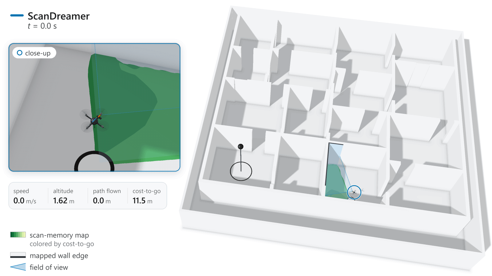
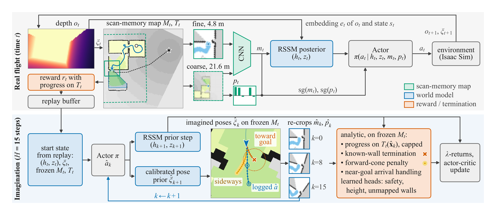
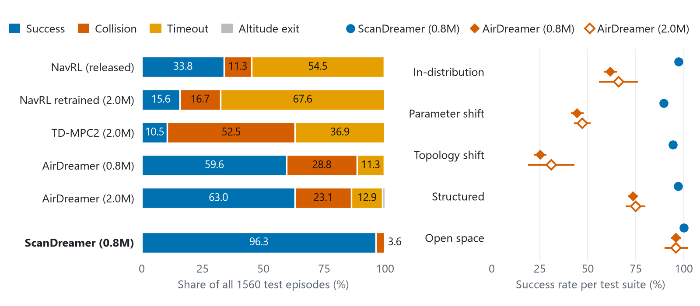
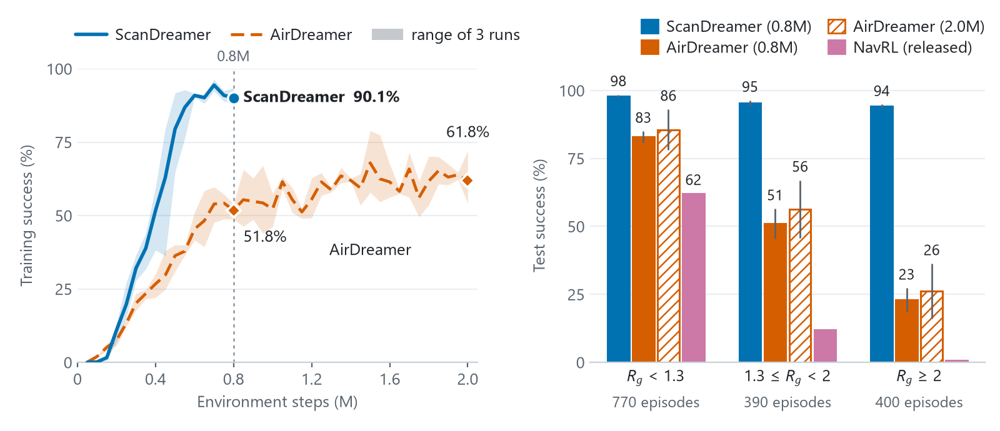
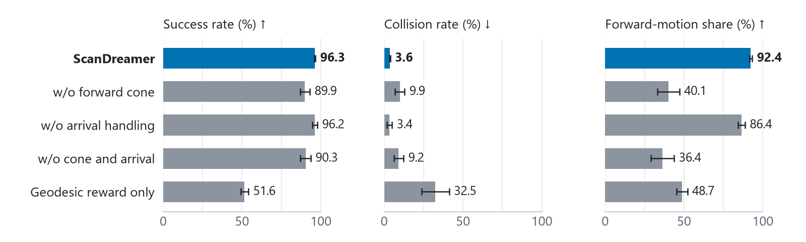
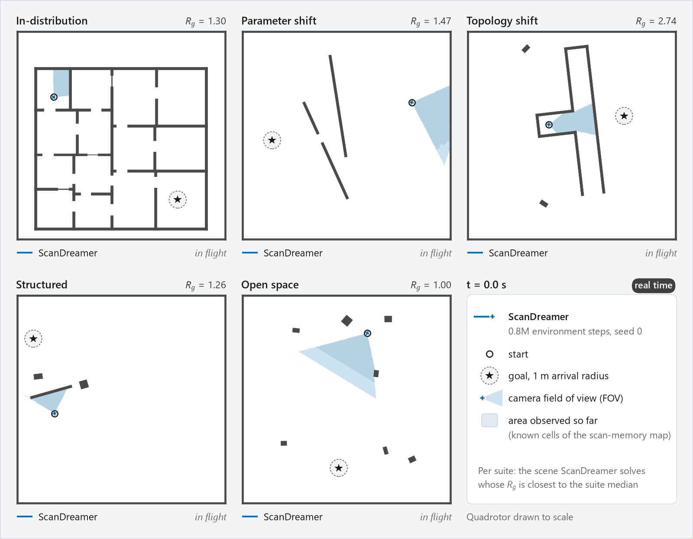
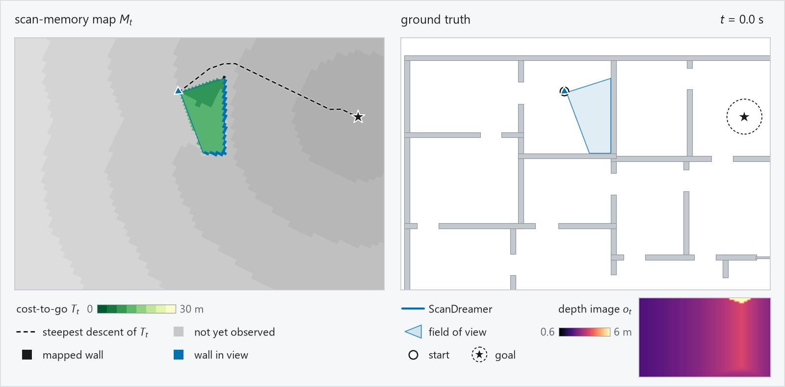

# ScanDreamer

Official repository for *ScanDreamer: A Map-Grounded World Model for Quadrotor Navigation*.

**Paper status:** Submitted to AICAP 2027; decision pending.

**Code availability:** The source code is not publicly available at this time. We plan to release the implementation in this repository upon acceptance of the paper.

<p align="center">
  
</p>
<p align="center"><sub>ScanDreamer flies through a 16-room building of the in-distribution test suite, shown in real time. The floor shows its scan-memory map, colored by the cost-to-go to the goal, and dark lines mark the wall edges the map holds. The close-up follows the quadrotor, drawn to scale, and the panel shows its logged speed, altitude, path length, and cost-to-go.</sub></p>

## Overview

ScanDreamer is a world-model agent for quadrotor navigation with a forward-facing depth camera. It builds a 2D scan-memory map online from depth images and pose, conditions its world model, actor, and critic on this map, and derives a geodesic progress reward from the cost-to-go over the mapped space. During imagination, the quadrotor pose moves over the frozen map, so progress and contacts with mapped walls come from the mapped geometry. A forward-cone penalty discourages horizontal motion outside the camera's field of view.

<p align="center">
  
</p>

## Results

All agents fly the same 1560 test episodes in NVIDIA Isaac Sim, drawn from five test suites with unseen layouts and parameter ranges.

| Method | Env. steps | Success (%) ↑ | Collision (%) ↓ | Timeout (%) ↓ | SPL ↑ |
|:--|:--:|:--:|:--:|:--:|:--:|
| NavRL, released | – | 33.8 | 11.3 | 54.5 | 0.324 |
| NavRL, retrained | 2.0M | 15.6 | 16.7 | 67.6 | 0.144 |
| TD-MPC2 | 2.0M | 10.5 | 52.5 | 36.9 | 0.095 |
| AirDreamer | 0.8M | 59.6 ± 3.0 | 28.8 ± 2.8 | 11.3 ± 0.8 | 0.496 ± 0.039 |
| AirDreamer | 2.0M | 63.0 ± 8.5 | 23.1 ± 5.4 | 12.9 ± 3.1 | 0.517 ± 0.089 |
| **ScanDreamer** | **0.8M** | **96.3 ± 0.3** | **3.6 ± 0.3** | **0.1 ± 0.0** | **0.831 ± 0.008** |

<sub>Mean ± SD over three seeds; NavRL and TD-MPC2 are single runs. The remaining episodes leave the altitude band.</sub>

<picture>
  <source media="(prefers-color-scheme: dark)" srcset="assets/results_dark.png">
  
</picture>
<p align="center"><sub>Left: outcomes of all 1560 test episodes. Right: success rate per test suite, as mean and SD over three seeds.</sub></p>

<picture>
  <source media="(prefers-color-scheme: dark)" srcset="assets/efficiency_dark.png">
  
</picture>
<p align="center"><sub>Left: success of training episodes in windows of 50k environment steps, as the mean and range over three runs. Right: test success by detour ratio R<sub>g</sub>, the shortest-path length divided by the start-goal distance.</sub></p>

<picture>
  <source media="(prefers-color-scheme: dark)" srcset="assets/ablation_dark.png">
  
</picture>
<p align="center"><sub>Variants of ScanDreamer after 0.8M environment steps, as mean and SD over three seeds. Without the forward-cone penalty, collisions rise from 3.6% to 9.9% and the share of forward motion drops from 92.4% to 40.1%.</sub></p>

## Test Flights

<p align="center">
  
</p>
<p align="center"><sub>ScanDreamer (seed 0, 0.8M environment steps) on one scene of each test suite, shown in real time. For every suite, we show the scene whose detour ratio is closest to the suite median among the scenes ScanDreamer solves.</sub></p>

<p align="center">
  
</p>
<p align="center"><sub>The flight from the top of this page, seen from above in real time. Left: the scan-memory map M<sub>t</sub>, colored by the cost-to-go T<sub>t</sub>, and the steepest descent of T<sub>t</sub> (dashed), which turns toward another door whenever a newly mapped wall closes the route. Right: the ground truth.</sub></p>

## Citation

```bibtex
@misc{gao2026scandreamer,
  title  = {{ScanDreamer}: A Map-Grounded World Model for Quadrotor Navigation},
  author = {Gao, Yunyi and Shi, Yixing and Liu, Yize and Tran, Hai-Duong and Nguyen, Nhat-Hoang P. and
            Wang, Shuai and Deng, Yi and Liu, Shengming and Goh, Sim Kuan and Pham, Duc-Thinh and Alam, Sameer},
  year   = {2026},
  note   = {Submitted to AICAP 2027}
}
```
